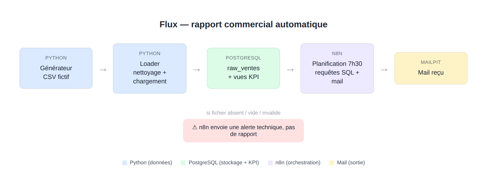
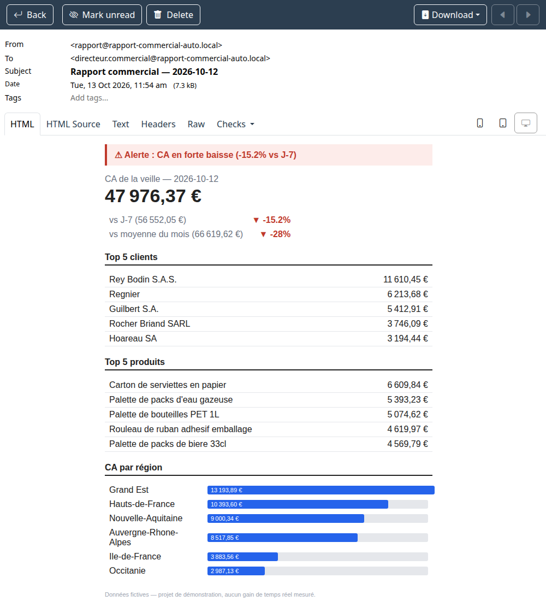

# Brief pour la présentation du projet sur le profil Malt

> Ce document rassemble tout le matériau nécessaire pour rédiger la fiche
> projet du profil Malt (description, images, résultat, compétences
> démontrées). Il est destiné à être donné tel quel à une autre session
> Claude, avec une consigne du type : « aide-moi à remplir mon profil Malt
> à partir de ce brief ». Toutes les images référencées sont dans ce même
> dossier (`docs/`).

## Lien du projet

- Dépôt GitHub (public) : https://github.com/emilienmarotta/rapport-commercial-auto
- README du projet (point d'entrée) : https://github.com/emilienmarotta/rapport-commercial-auto/blob/main/README.md

## Pitch court (2-3 lignes, pour un champ "résumé")

Automatisation d'un rapport commercial quotidien envoyé par mail : un
fichier de ventes façon export ERP est nettoyé, chargé en base, agrégé en
SQL et mis en forme automatiquement chaque matin — sans intervention
humaine. Projet portfolio avec données 100 % fictives, construit en
méthode specs-driven (chaque brique spécifiée puis codée).

## Contexte / problème (pour un champ "description", partie 1)

Scénario fictif : dans une PME de commerce de gros, le directeur commercial
perd chaque matin 20 à 30 minutes à ouvrir l'ERP, exporter un fichier et le
mettre en forme pour avoir une vision de l'activité de la veille (chiffre
d'affaires, comparaisons, clients et produits qui tirent l'activité,
répartition géographique). Un travail répétitif, manuel, et propice aux
oublis ou aux erreurs de mise en forme.

## Solution (pour un champ "description", partie 2)

Chaque matin à 7h30, le directeur commercial reçoit un mail automatique
avec les chiffres de la veille : CA, comparaison à J-7 et à la moyenne du
mois (avec flèches de tendance colorées), top 5 clients, top 5 produits, CA
par région, et une alerte visuelle en cas de forte baisse. Si le fichier
source est absent, vide ou invalide, un mail d'alerte technique est envoyé
à la place — jamais un rapport avec des chiffres faux ou à zéro.

### Schéma du flux



```
Générateur de données → CSV « export ERP » → Python (nettoyage + chargement)
→ PostgreSQL → n8n (planification + requêtes SQL + mise en forme) → Mail
```

## Résultat (pour un champ "résultat" / "démo")

Capture du mail réellement reçu dans la boîte de test (Mailpit), pendant un
déclenchement du workflow contre des données générées :



Le mail est lisible en moins de 30 secondes : chiffre clé en gros en haut,
flèches vertes/rouges selon la tendance, tableaux courts, mini-graphique en
barres pour la répartition régionale.

## Ce que le projet démontre techniquement (pour un champ "compétences")

- **Python** : génération de données réalistes, nettoyage et chargement
  idempotent en base (rejouable sans dupliquer), petite API HTTP interne
  (Flask) pour exposer ce traitement à l'orchestrateur.
- **SQL (PostgreSQL)** : toute la logique d'agrégation métier (CA, écarts,
  tops, alerte sur seuil) est portée par des vues SQL, pas par du code
  applicatif — chaque KPI est un `SELECT` lisible et auditable.
- **Orchestration (n8n)** : planification, enchaînement HTTP → base de
  données → mise en forme → envoi, avec branche d'erreur explicite et
  conditionnelle (`If` node sur le code retour).
- **Docker / Docker Compose** : stack multi-services (PostgreSQL, n8n,
  Mailpit, API interne), réseau interne, volumes, variables d'environnement.
- **Conception et rigueur** : répartition stricte des responsabilités entre
  les couches (aucune logique métier dupliquée entre Python et n8n),
  méthode *specs-driven* (une spec écrite et validée avant chaque brique de
  code), workflow Git avec une branche et une pull request par milestone.
- **Résolution de contrainte réelle** : l'image Docker `n8n` utilisée est
  une image durcie sans gestionnaire de paquets, donc impossible d'y
  installer Python pour un nœud "Execute Command" classique. Contournement
  documenté et mis en œuvre : exposer le loader via une API HTTP interne
  plutôt que de l'invoquer en ligne de commande — un bon exemple de
  contournement d'une contrainte d'infrastructure sans sacrifier la
  séparation des responsabilités.

## Compétences / tags suggérés

Python · SQL · PostgreSQL · Docker / Docker Compose · n8n (no-code /
automatisation) · ETL léger · conception de pipeline de données ·
spécification technique (specs-driven development) · Git / GitHub (PR,
revue, branches) · automatisation de reporting.

## Méthodologie de travail (bon point pour un profil freelance)

Projet découpé en 7 milestones (M0 à M6), chacun livré via une branche
dédiée et une pull request vers `main`, avec des spécifications écrites
avant le code dans [`specs/`](../specs/) :

1. Squelette + environnement Docker.
2. Générateur de données fictives (CSV façon export ERP).
3. Chargement PostgreSQL idempotent.
4. Vues SQL des KPI.
5. Workflow n8n (planification, branche d'erreur).
6. Template du mail (mise en forme, mini-graphique).
7. Livrables portfolio (ce document, README, captures).

Détail : [ROADMAP.md](../ROADMAP.md) et [specs/README.md](../specs/README.md).

## Honnêteté / limites assumées (à ne pas occulter dans la présentation)

- Toutes les données sont **fictives**, générées par script — aucun lien
  avec un vrai ERP ni une vraie entreprise.
- Le gain de temps n'est **pas mesuré** : c'est une hypothèse de scénario
  (20 min/jour perdues × 220 jours ouvrés ≈ 73 h/an), présentée comme telle.
- Démo locale uniquement (`docker compose up`), pas d'hébergement, pas
  d'envoi de mail réel (capté par Mailpit).
- Pas d'authentification multi-utilisateurs ni de volumétrie réaliste : le
  projet démontre un mécanisme, pas un produit prêt pour la production.

## Pour la session Claude qui reçoit ce brief

Objectif : aider à remplir une fiche de projet sur le profil Malt de
l'utilisateur (probablement : titre, description courte, description
longue, compétences/tags, rôle sur le projet, lien vers le dépôt, visuels).
Utiliser le contenu ci-dessus comme matière première, l'adapter au format
et à la longueur exacte demandés par les champs du profil Malt, en gardant
le ton honnête sur le caractère "démo / données fictives" du projet (ne
jamais présenter le gain de temps comme un résultat mesuré).
